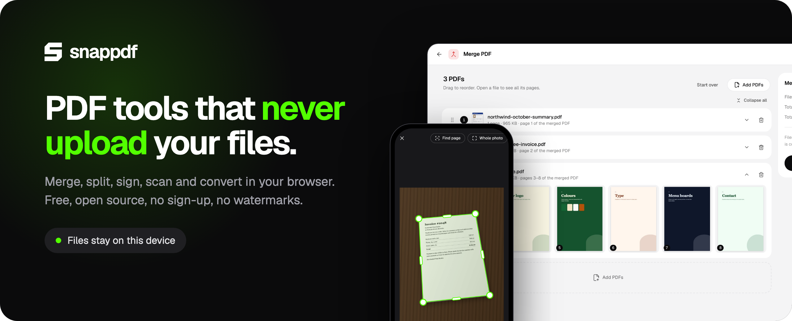
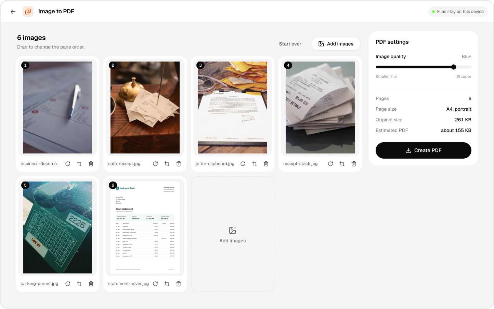
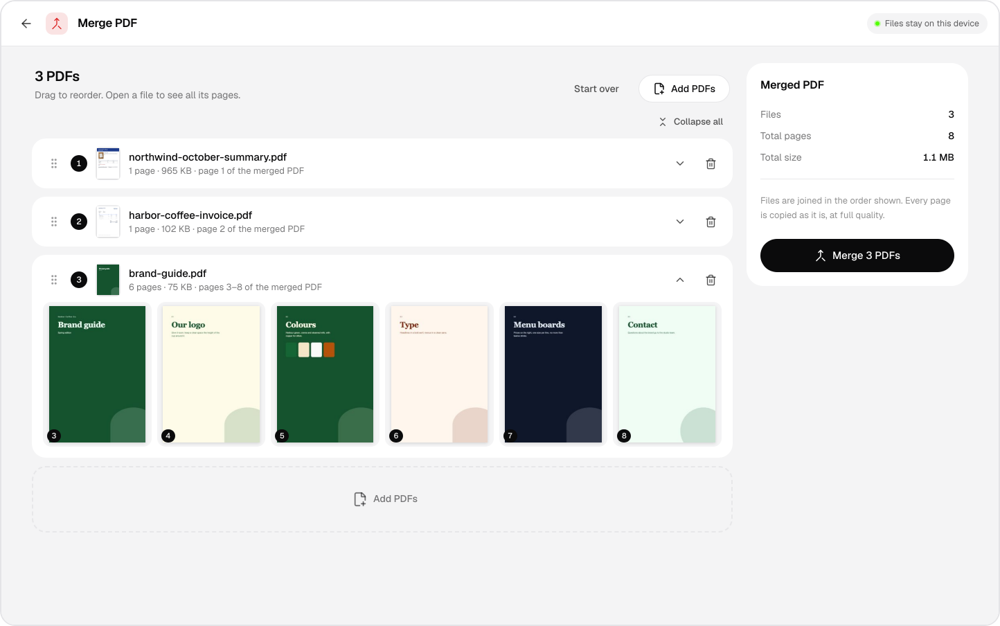
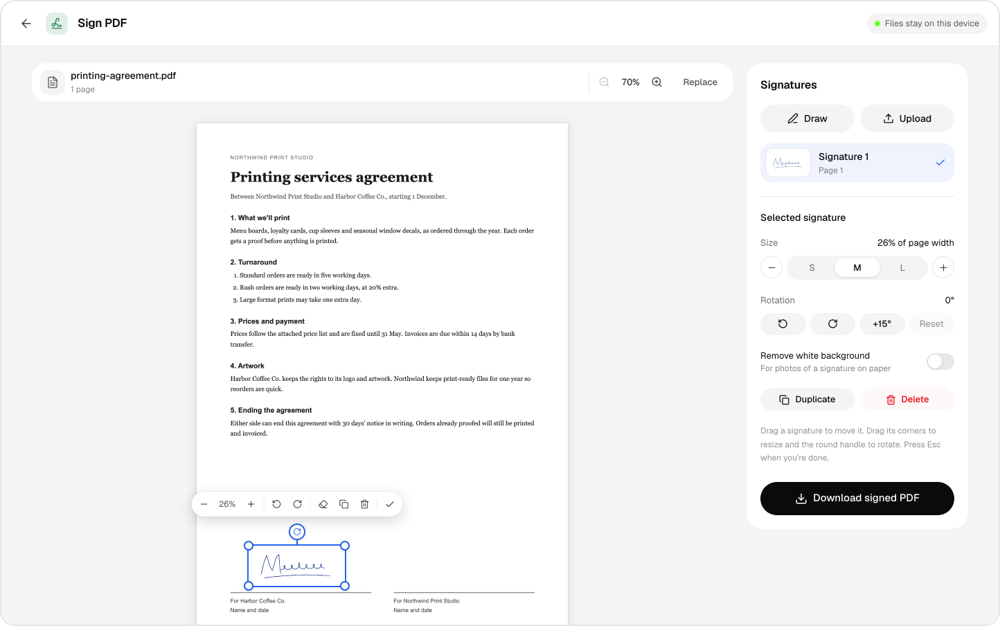
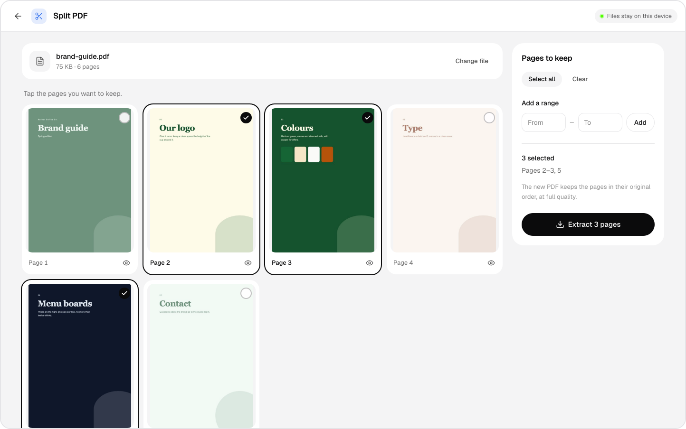
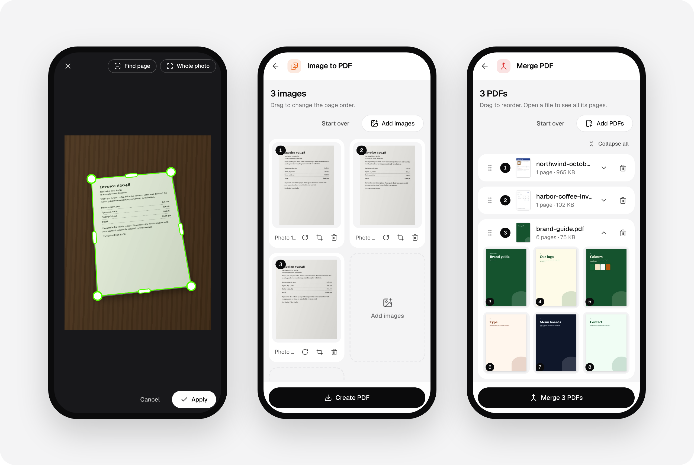
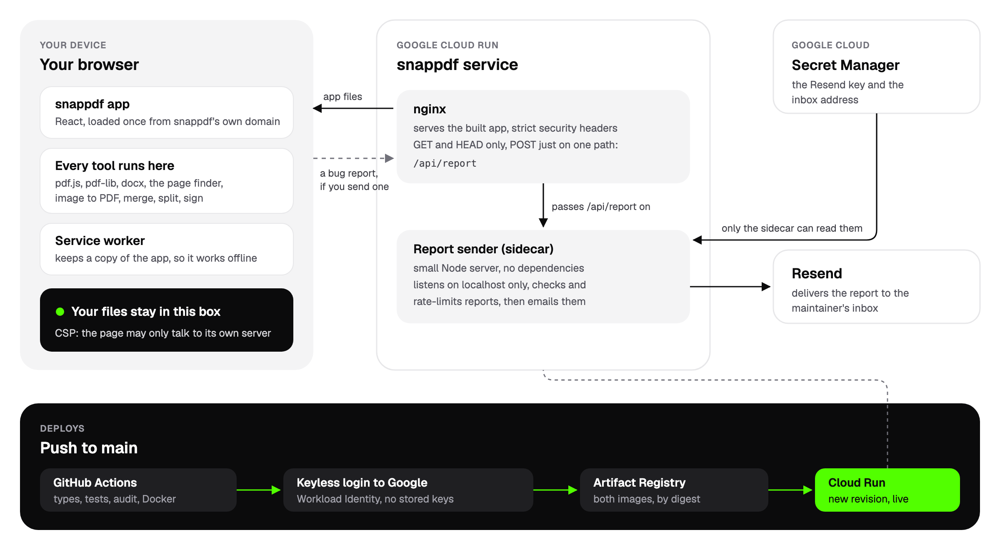

<div align="center">



<br>
<br>


<a href="LICENSE"></a>

<br>
<br>

**[Open snappdf](https://snappdf.abrahamalgorithm.tech)** &nbsp;·&nbsp; [Features](#features) &nbsp;·&nbsp; [How it works](#how-it-works) &nbsp;·&nbsp; [Run it locally](#run-it-locally)

</div>

<br>

snappdf is a free PDF toolkit that runs entirely in your browser. Turn photos into a PDF, merge, split and sign PDFs. Your files are read and written on your device and never uploaded. There's no account to make and nothing gets a watermark.

On a phone, take a photo of a page and snappdf finds its edges, straightens it and adds it as a flat page, like a scanner app. Once it's loaded, it keeps working with no internet.

## Features

<table>
  <tr>
    <td width="50%" valign="top">
      
      <p><b>Image to PDF</b><br>Photos, screenshots and scans, iPhone HEIC included, into one PDF. Drag them into order, rotate and crop them, and pick the quality to trade sharpness for file size.</p>
    </td>
    <td width="50%" valign="top">
      
      <p><b>Merge PDF</b><br>Combine PDFs in the order you choose. Open any file to see all its pages and where each one lands in the merged PDF. Pages are copied as they are, at full quality.</p>
    </td>
  </tr>
  <tr>
    <td width="50%" valign="top">
      
      <p><b>Sign PDF</b><br>Draw your signature or upload a photo of it, then drag it into place, resize it and rotate it. A photo of a signature on paper can have its white background taken out.</p>
    </td>
    <td width="50%" valign="top">
      
      <p><b>Split PDF</b><br>Tap the pages you want to keep, or type a range, and save them as a new PDF.</p>
    </td>
  </tr>
</table>

### And the rest

- **CSV and JSON.** CSV to Excel, JSON to Excel and JSON to CSV.
- **Works offline.** After the first visit the app is saved on your device, so it opens and works with no connection, and it installs like an app.
- **Switch tools without losing work.** A tool you've opened keeps its files until you close the tab.
- **A report form.** [Report a bug or request a feature](https://snappdf.abrahamalgorithm.tech/report) and it lands in the maintainer's inbox.

### On your phone

The same tools, laid out for small screens. Take a photo of a page and snappdf finds it and flattens it. If it picks the wrong outline, drag the corners, with a magnifier under your finger.

<p align="center">
  
</p>

## How it works



snappdf is a static React app. nginx serves it from Cloud Run, and everything you do with a file happens in your browser tab, so the server never sees your files. The only other thing the server does is pass bug reports to a small Node sidecar in the same Cloud Run service, which emails them to the maintainer.

## Security and privacy

- **Your files stay on your device.** There's no upload step. Every tool runs in your browser tab, and your files are read and written there.
- **The browser enforces it.** The [Content-Security-Policy](nginx.conf) only lets the page talk to its own server (`connect-src 'self'`), and every script and font comes from snappdf's own domain. There are no analytics, ads or third-party requests.
- **The server has nowhere to put them.** [nginx](nginx.conf) answers `GET` and `HEAD`. The only `POST` it accepts is `/api/report`, the bug report form, which sends only what you type into it and is capped at 16 KB.
- **Try it yourself.** Open a tool, turn on airplane mode and keep working.
- **No secrets in this repo.** The bug report sender's credentials sit in Secret Manager in production and in `.env` locally. Only the report sender can read them, and they never reach the browser.
- **No stored cloud credentials.** Deploys log in to Google with Workload Identity Federation, and Google only accepts that login from this repo's `main` branch. The deploy account can push images and deploy this one service, nothing else.
- **Small, locked-down containers.** nginx runs as a non-root user. The report sender has no npm dependencies, runs as the `node` user and listens on localhost only. CI installs packages with `--ignore-scripts` and fails on high-severity vulnerabilities in anything that ships.

The [privacy policy](https://snappdf.abrahamalgorithm.tech/privacy) covers the rest, including what the server's request logs contain. Found a vulnerability? Please report it privately through the repository's **Security** tab instead of opening a public issue.

## Run it locally

You'll need Node.js 22.12 or newer.

```bash
git clone https://github.com/AbrahamAlgorithm/snappdf.git
cd snappdf
npm install
npm run dev                            # http://localhost:3000
```

Offline mode only switches on in production builds, so try it with `npm run build && npm run preview`.

## License

MIT, see [LICENSE](LICENSE).

## Contact

Built by Abraham Folorunso ([@AbrahamAlgorithm](https://github.com/AbrahamAlgorithm), [abrahamalgorithm.tech](https://abrahamalgorithm.tech)). Questions, ideas or bugs: the [report form](https://snappdf.abrahamalgorithm.tech/report), abrahamfolorunso6@gmail.com, or open an issue. Pull requests are welcome, and each one runs the type check, tests, build, audit and both Docker builds.

If snappdf is useful to you, a ⭐ on the repo helps others find it.
