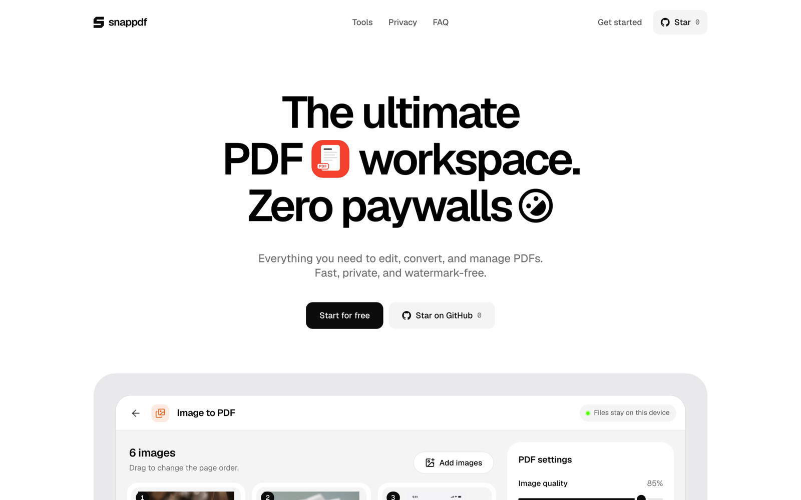

# snappdf



> The ultimate PDF workspace. Zero paywalls.

snappdf is a free, open-source PDF toolkit that runs entirely in your browser. Edit, convert and sign documents without uploads, sign-ups or watermarks. Your files never leave your device.

## Links

- **Live app**: [snappdf.abrahamalgorithm.tech](https://snappdf.abrahamalgorithm.tech)
- **Report a bug or request a feature**: [Open an issue](https://github.com/AbrahamAlgorithm/snappdf/issues)

## Features

- **Image to PDF**: Turn photos, screenshots and scans (including iPhone HEIC) into one PDF. Reorder, rotate and crop. On a phone, take photos with the camera straight into the PDF.
- **Merge PDF**: Combine several PDFs into one, in the order you choose.
- **Split PDF**: Pick the pages you need and save them as a new PDF.
- **Sign PDF**: Draw or upload your signature and place it on any page.
- **Text to PDF**: Type, paste or open a text file and save it as a PDF.
- **Converters**: PDF to Word, CSV or JSON to Excel, and JSON to CSV.
- **Private by design**: Everything runs on your device. Nothing is uploaded.
- **Works offline**: After the first visit it opens and works with no internet, and you can install it like an app.

## Run it locally

You need Node.js 22 or newer.

```bash
git clone https://github.com/AbrahamAlgorithm/snappdf.git
cd snappdf
npm install
npm run dev
```

Then open [http://localhost:3000](http://localhost:3000).

Run the tests with `npm test`. Offline mode is only switched on in production builds, so try it with `npm run build && npm run preview`.

## Contribution

Contributions are welcome. To contribute:

1. Fork the repository.
2. Create a branch (`git checkout -b feat/your-feature`).
3. Commit your changes.
4. Push the branch and open a Pull Request.

Every pull request runs a type check, tests, build and security audit before it can be merged.

## Security

Found a vulnerability? Please report it privately through the repository's **Security** tab ("Report a vulnerability") instead of opening a public issue.

## License

[MIT](LICENSE)

## Author

Built by **[Abraham Folorunso](https://github.com/AbrahamAlgorithm)**.

---

If you find this project useful, please **⭐ Star** the repository!
