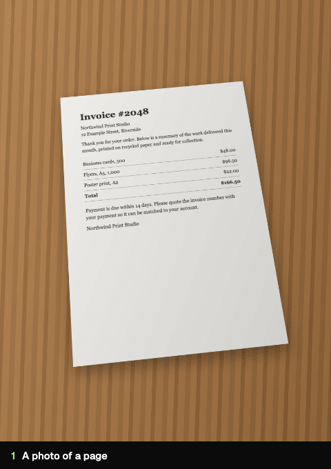

# snappdf

**Your files never leave your device.** snappdf is a free, open-source PDF toolkit that runs entirely in your browser: no uploads, no sign-ups, no watermarks.


**[Open snappdf](https://snappdf.abrahamalgorithm.tech)** · [Privacy policy](https://snappdf.abrahamalgorithm.tech/privacy) · [Report a bug or request a feature](https://snappdf.abrahamalgorithm.tech/report)

## Features

- **Image to PDF**: turn photos, screenshots and scans (including iPhone HEIC) into one PDF. Reorder, rotate and crop. On a phone, take photos with the camera and snappdf finds the page, crops it and straightens it, like a scanner app.
- **Merge PDF**: combine PDFs in the order you choose, with every page previewed.
- **Split PDF**: pick the pages you need and save them as a new PDF.
- **Sign PDF**: draw or upload your signature and place it on any page.
- **Text to PDF**: type, paste or open a text file and save it as a PDF.
- **PDF to Word**: a Word file that looks just like the PDF, with every word editable. [How it works](#pdf-to-word).
- **CSV and JSON**: convert to Excel, or JSON to CSV.
- **Works offline**: after the first visit it opens and works with no internet, and installs like an app.

## How do I know my files stay private?

You don't have to take our word for it. It's enforced in four places you can check:

1. **There's no upload step.** Every tool (pdf.js, pdf-lib, docx, the page finder) runs in your browser tab. Your files are read and written on your device.
2. **The browser won't let the page send them anywhere.** The site's [Content-Security-Policy](nginx.conf) only allows the page to talk to its own server (`connect-src 'self'`), and every script and font comes from snappdf's own domain. There are no analytics, ads or third-party requests.
3. **The server has nowhere to put them.** [nginx](nginx.conf) answers `GET` and `HEAD` only. The single `POST` it accepts is `/api/report`, the bug report form, which sends only what you type into it.
4. **Try it yourself.** Open a tool, turn on airplane mode, and keep working. A service worker keeps a copy of the app, so nothing needs the network once it's loaded.

The [privacy policy](https://snappdf.abrahamalgorithm.tech/privacy) covers the rest, including what the server's request logs contain.

## How the scanner works

<p align="center"></p>

When you take a photo in Image to PDF, snappdf finds the page (in under 20 ms on a laptop) and flattens it, with no library: [src/lib/scan.ts](src/lib/scan.ts) is plain pixel maths. OpenCV.js would have added an 8 MB download.

1. **Edges (Sobel).** The photo is shrunk to 400 px and blurred, then a Sobel filter measures how strongly and which way the colour changes at every pixel. It uses whichever colour channel changes most, so a white page on a cream cloth still has an edge. A second, blurrier copy turns a spiral binding's row of rings into one clean edge.
2. **Straight lines (Hough transform).** Each edge pixel votes for the lines it could sit on, facing the way its edge faces. The 24 strongest distinct lines go forward. When a page runs off the photo, the photo's own border can stand in for that side.
3. **Quad scoring.** Every four lines are tried as two pairs of opposite sides. Shapes that can't be a page are dropped: corners outside 50° to 130°, too small, or folded. The rest are scored on how much of each side runs along a real edge, and how different it looks just inside the side compared with just outside (paper against table). One weak side is allowed, for a spiral or a thumb.
4. **Homography.** The eight numbers that map a rectangle onto the chosen corners are solved directly, and every pixel of the flat page is sampled from the photo.
5. **Aspect ratio recovery.** A page shot at an angle looks shorter than it is. Its real width and height are recovered from the four corners and the camera geometry (Zhang and He, *Whiteboard scanning and image enhancement*, 2007), so an A4 page comes out A4-shaped.

If it picks the wrong outline, the corner editor lets you drag the corners or edges, with a magnifier under your finger.

The [tests](src/lib/scan.test.ts) check it on generated photos: pages tilted and shot at an angle on cloth, wood and a light table, under uneven light and shadows, with ruled lines, a printed table, a spiral notebook and a page running off the photo. A stress test of 200 random photos has to find at least 95% of them within 2% of the true corners (it finds 193).

## PDF to Word

A Word file should look like the PDF and still be editable, so there's one output that does both, made on your device ([src/lib/pdfToWord.ts](src/lib/pdfToWord.ts)). Each page becomes two layers:

1. **The page without its words, behind everything.** pdf.js draws the page twice, once as it is and once with its text left out. The second drawing keeps every picture, colour, line, table border and logo exactly as it was.
2. **The words on top, as real text.** Every line goes back where it was, in a Word text frame, in the same font, size, bold, italic and colour. Lines that belong together share one frame, so a paragraph stays a paragraph. [src/lib/pdfLayout.ts](src/lib/pdfLayout.ts) works out lines, paragraphs, columns and reading order from where the text sits.

A PDF doesn't plainly say what colour its text is, so it's read from the two drawings: the pixels that changed are the letters, and their solid middles give the colour.

| Kept | Not yet |
| --- | --- |
| The exact look: pictures, colours, lines and backgrounds | Tables are text over the drawn grid, not Word tables |
| Every word editable, in its font, size and colour | Text you add grows its own frame, it doesn't push the rest of the page down |
| Bold and italic, also in fonts embedded in the PDF | Reading text out of scanned pages (no OCR yet) |
| Headings as Word heading styles, so the navigation pane works | Turned text (a side label, a stamp) stays part of the picture |
| Columns, even ones that start part way down a page | |
| Each page's size, so landscape stays landscape | |

Word shows each font from your computer, so if you don't have the PDF's font it uses a close one. Scanned pages have no text to read, so they go in as pictures and you're told which ones.

[Its tests](src/lib/pdfToWord.test.ts) build PDFs with known layouts, including fonts embedded the way real PDFs carry them, convert them, then unzip the `.docx` and check the XML: each line's frame where it was on the page, a paragraph kept in one frame, `<w:b/>` on bold words, text colours, `Heading1` styles, column order, page orientation, and scans detected.

## How it's built

A static React app served by nginx on Google Cloud Run, with a small Node sidecar for bug reports. Its email key lives in Secret Manager and only the sidecar can read it. Every push to `main` is tested and deployed from GitHub Actions, which logs in to Google with keyless Workload Identity Federation, so no cloud credentials are stored anywhere.


## Run it locally

You need Node.js 22.12 or newer.

```bash
git clone https://github.com/AbrahamAlgorithm/snappdf.git
cd snappdf
npm install
npm run dev
```

Then open [http://localhost:3000](http://localhost:3000).

- `npm test` runs the tests: the page finder on generated photos, PDF to Word on fixture PDFs, merge, split and image to PDF, and the report server.
- Offline mode only switches on in production builds, so try it with `npm run build && npm run preview`.
- The report form works locally if `.env` has `RESEND_API_KEY` and `REPORT_TO`. Without them it says reports aren't set up, and everything else works as normal.

## Contribution

Contributions are welcome. To contribute:

1. Fork the repository.
2. Create a branch (`git checkout -b feat/your-feature`).
3. Commit your changes.
4. Push the branch and open a pull request.

Every pull request runs the type check, tests, build, a security audit and both Docker builds before it can be merged.

## Security

Found a vulnerability? Please report it privately through the repository's **Security** tab ("Report a vulnerability") instead of opening a public issue.

## License

[MIT](LICENSE)

## Author

Built by **[Abraham Folorunso](https://abrahamalgorithm.tech)**.

---

If you find this project useful, please **⭐ Star** the repository!
